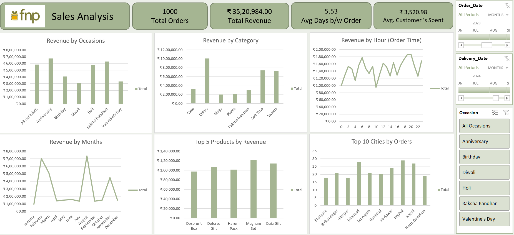

# 📊 Ferns and Petals Sales Analysis Dashboard (Excel)

## 📌 Project Overview
This project is a **FNP Sales Analysis Dashboard** built using **Microsoft Excel**, designed to analyze customer behavior, product performance, and order trends. The dashboard provides **actionable insights** through interactive visuals and structured datasets, making it suitable for business decision-making and reporting.

The spreadsheet integrates multiple datasets and transforms raw data into a **clear, insightful dashboard** for sales monitoring and performance evaluation.

---

## 🗂️ Dataset Structure
The Excel file contains the following sheets:

- **Customers** – Customer details and segmentation data  
- **Orders** – Transaction-level order data including sales and quantities  
- **Products** – Product information and pricing details  
- **FNP Datasets** – Raw or supporting data used for analysis  
- **Dashboard** – Interactive visual dashboard summarizing key insights  

---

## 📈 Key Dashboard Insights
- 💰 **Total Sales & Revenue Trends**
- 👥 **Customer Purchase Patterns**
- 📦 **Top-Selling Products**
- 📊 **Order Volume Analysis**
- 📅 **Time-Based Sales Performance**

---

## 🛠️ Tools & Technologies Used
- **Microsoft Excel**
  - Pivot Tables
  - Pivot Charts
  - Slicers & Filters
  - Data Cleaning & Formatting
- **Data Analysis Techniques**
  - Aggregation & Summarization
  - Trend Analysis
  - KPI Calculation

---

## 🖼️ Dashboard Preview
> 

📷 Suggested file path:
images/dashboard.png
